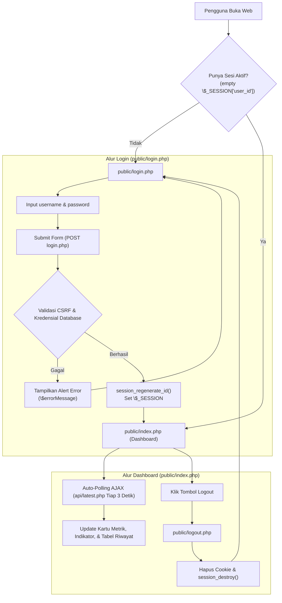

# Dokumentasi Arsitektur UI/UX & Spesifikasi Frontend (Google Stitch Master Reference)

> **File Acuan**: `design.md`  
> **Target Proyek**: Smart Laundry Basket System IoT  
> **Tujuan**: Dokumen spesifikasi teknis dan panduan batasan (*guardrails*) untuk proses refactoring antarmuka (UI/UX) menggunakan **Google Stitch**, memastikan modernisasi visual tidak merusak logika backend PHP, proteksi sesi, CSRF, maupun mekanisme auto-polling AJAX.

---

## 1. Inventaris Halaman & Alur Navigasi (User Flow)

Sistem antarmuka web Smart Laundry Basket terdiri dari 2 halaman pengguna utama dan 1 endpoint proses terminasi sesi:



### 1.1 Halaman Login (`public/login.php`)
* **URL**: `/login.php`
* **Logika Proteksi Awal**:
  ```php
  startSecureSession();
  if (!empty($_SESSION['user_id'])) {
      header('Location: index.php');
      exit;
  }
  ```
  Jika pengguna sudah memiliki sesi login aktif, server otomatis mengalihkan (*redirect 302*) ke `index.php`.
* **Struktur Form**:
  * **Tag Form**: `<form method="POST" action="login.php" autocomplete="off">`
  * **CSRF Token (Wajib)**: `<input type="hidden" name="csrf_token" value="<?= htmlspecialchars($csrfToken, ENT_QUOTES, 'UTF-8') ?>">`
  * **Field Username**:
    * `type="text"`, `id="username"`, `name="username"`
    * `required`, `autofocus`, `value="<?= htmlspecialchars($usernameVal, ENT_QUOTES, 'UTF-8') ?>"` (mempertahankan input username jika login gagal).
  * **Field Password**:
    * `type="password"`, `id="password"`, `name="password"`
    * `required`
  * **Tombol Submit**: `<button type="submit" class="btn-submit">`
* **Mekanisme Tampilan Error PHP**:
  ```php
  <?php if (!empty($errorMessage)): ?>
      <div class="alert-error">
          <svg ...></svg>
          <span><?= htmlspecialchars($errorMessage, ENT_QUOTES, 'UTF-8') ?></span>
      </div>
  <?php endif; ?>
  ```
  Pesan error ditampilkan di atas form jika validasi CSRF gagal atau kombinasi username/password salah.

---

### 1.2 Halaman Dashboard Pemantauan (`public/index.php`)
* **URL**: `/index.php`
* **Logika Proteksi Sesi**:
  ```php
  startSecureSession();
  if (empty($_SESSION['user_id'])) {
      header('Location: login.php');
      exit;
  }
  $currentUser = $_SESSION['username'] ?? 'User';
  ```
  Halaman memverifikasi keberadaan `$_SESSION['user_id']`. Jika tidak ada, pengguna langsung diarahkan ke `login.php`.
* **Struktur Navigasi & Header**:
  * **Navbar Atas (`.navbar`)**:
    * Identitas aplikasi: Icon SVG mesin cuci, title `"Smart Laundry Basket"`, subtitle `"IoT Real-time Telemetry Dashboard"`.
    * Indikator status polling: `#connection-status-badge` dengan animasi `#connection-pulse` dan teks `#connection-text` (*Live Sync 3s*).
    * Informasi user: Menampilkan nama pengguna yang sedang aktif via `<?= htmlspecialchars($currentUser, ENT_QUOTES, 'UTF-8') ?>`.
    * Tautan Logout: `<a href="logout.php" class="btn-logout">` yang memicu penghancuran sesi.
* **Komponen & Tata Letak Konten Utama (`.main-container`)**:
  * **Overview Header (`.page-header`)**: Judul pemantauan, subjudul, waktu update terakhir (`#last-update-text`), dan tombol refresh manual (`#btn-manual-refresh`).
  * **Grid Kartu Metrik (`.metric-grid`)**:
    1. Kartu Kapasitas Pakaian (`#card-capacity`): Mengukur jarak bibir ke pakaian (HC-SR04).
    2. Kartu Indikator Bau Gas (`#card-gas`): Mengukur konsentrasi gas senyawa volatil (MQ-135).
    3. Kartu Status Aktuator: Menampilkan status fisik LED Merah (GPIO 25) dan Active Buzzer (GPIO 26).
  * **Seksi Tabel Riwayat (`.table-section`)**: Tabel riwayat 5 rekaman telemetri terbaru (`#table-history-body`) yang diperbarui secara asinkron.
  * **Footer (`.footer`)**: Keterangan sistem dan kesiapan simulator.

---

### 1.3 Endpoint Pembersihan Sesi (`public/logout.php`)
* **URL**: `/logout.php`
* **Perilaku**:
  1. Memanggil `startSecureSession()`.
  2. Mengosongkan array sesi: `$_SESSION = [];`.
  3. Menghapus cookie sesi dari browser client dengan *expiration date* masa lampau (`time() - 42000`).
  4. Menghancurkan sesi server: `session_destroy()`.
  5. Mengalihkan pengguna ke `login.php` (`header('Location: login.php'); exit;`).

---

## 2. Kontrak DOM & Data Binding (KRITIS - Dilarang Diubah Saat Refactor UI)

Tabel berikut memuat seluruh elemen HTML yang terikat langsung (*hardcoded data binding*) dengan skrip JavaScript di `public/index.php`. Saat merancang ulang menggunakan Google Stitch, **seluruh ID dan elemen ini wajib dipertahankan**:

| ID Elemen / Selector | Tag HTML Asli | Halaman | Data / Nilai yang Ditampilkan | Aturan Manipulasi CSS / Kelas Dinamis oleh JS |
| :--- | :--- | :--- | :--- | :--- |
| `connection-status-badge` | `<div>` | `index.php` | Kontainer badge status sinkronisasi | Berubah background, color, & borderColor: hijau saat terhubung, merah saat offline/error. |
| `connection-pulse` | `<span>` | `index.php` | Dot animasi berdenyut | `style.backgroundColor` hijau (`var(--status-green)`) saat online, merah (`var(--status-red)`) saat error. |
| `connection-text` | `<span>` | `index.php` | Teks status jaringan | Teks `Live Sync (3s)` saat online, atau pesan galat seperti `Offline / Error`. |
| `last-update-text` | `<strong>` | `index.php` | Timestamp pembaruan data | Menampilkan string tanggal & waktu rekaman sensor (`latest.dibuat_pada` atau `payload.server_time`). |
| `btn-manual-refresh` | `<button>` | `index.php` | Tombol picu refresh manual | Menjalankan rotasi ikon SVG `rotate(180deg)` saat diklik lalu memanggil `fetchLatestData()`. |
| `card-capacity` | `<div>` | `index.php` | Kontainer kartu jarak kapasitas | Wrapper kartu untuk metrik ultrasonik HC-SR04. |
| `val-distance` | `<span>` | `index.php` | Nilai numerik jarak pantul | Menampilkan angka jarak float 1 desimal (contoh: `8.8` atau `--` jika kosong). |
| `badge-capacity` | `<span>` | `index.php` | Badge teks status kepenuhan | Jika penuh ($d \le 10\text{ cm}$): teks `KERANJANG PENUH`, class `metric-badge badge-red`. Jika normal: teks `KAPASITAS AMAN`, class `metric-badge badge-green`. |
| `progress-capacity` | `<div>` | `index.php` | Progress bar pengisian keranjang | `style.width = fillPct + '%'`. `style.backgroundColor`: `var(--status-red)` jika penuh, `var(--status-green)` jika normal. |
| `label-capacity-pct` | `<span>` | `index.php` | Persentase kapasitas terisi | Menampilkan teks persentase terisi (contoh: `85% Terisi`), dihitung dari rentang 40 cm (0%) hingga 10 cm (100%). |
| `card-gas` | `<div>` | `index.php` | Kontainer kartu metrik gas | Wrapper kartu untuk metrik sensor analog MQ-135. |
| `val-gas` | `<span>` | `index.php` | Nilai mentah ADC gas | Menampilkan bilangan bulat integer ADC 12-bit (0–4095). |
| `badge-gas` | `<span>` | `index.php` | Badge teks kualitas udara/bau | * Jika $\ge 2500$: `BAU TERDETEKSI`, class `metric-badge badge-red`.<br>* Jika $2000 - 2500$: `NORMAL`, class `metric-badge badge-amber`.<br>* Jika $\le 2000$: `TIDAK BAU`, class `metric-badge badge-green`. |
| `progress-gas` | `<div>` | `index.php` | Progress bar konsentrasi gas | `style.width = gasPct + '%'`. Warna: `var(--status-red)` (Bau), `var(--status-amber)` (Normal), atau `var(--status-green)` (Tidak Bau). |
| `label-gas-threshold` | `<span>` | `index.php` | Label ambang tengah gas | Menampilkan teks referensi rentang ambang batas `2000 - 2500 (Normal)`. |
| `val-actuator-summary` | `<span>` | `index.php` | Ringkasan alarm aktuator | Teks `ALARM AKTIF!` + color red jika penuh/bau. Teks `STANDBY NORMAL` + color green jika aman. |
| `status-led` | `<strong>` | `index.php` | Status nyala LED Merah | Teks `MENYALA` + class `tag-pill pill-red` jika alarm aktif. Teks `PADAM` + class `tag-pill pill-green` jika standby. |
| `status-buzzer` | `<strong>` | `index.php` | Status bunyi Active Buzzer | Teks `BUNYI ALARM` + class `tag-pill pill-red` jika alarm aktif. Teks `HENING` + class `tag-pill pill-green` jika standby. |
| `status-servo` | `<span>` | `index.php` | Status fisik penutup keranjang (Smart Lid) | Teks `Tutup Terbuka (Aktif)` + class `text-secondary` saat `status_tutup === 1`. Teks `Tutup Tertutup` + class `text-on-surface-variant` saat `0`. |
| `dot-servo` | `<span>` | `index.php` | Indikator titik status servo | `bg-secondary animate-pulse` saat terbuka, `bg-outline-variant` saat tertutup. |
| `table-history-body` | `<tbody>` | `index.php` | Kontainer baris data riwayat | Diisi secara dinamis dengan string HTML `<tr>...</tr>` hasil mapping 5 item array `history`. |

### 2.1 Elemen Form Input pada `login.php` (Wajib untuk Autentikasi PHP)
| Atribut / ID | Tag HTML | Tipe Input | Fungsi |
| :--- | :--- | :--- | :--- |
| `name="csrf_token"` | `<input>` | `hidden` | Token keamanan CSRF yang diverifikasi oleh `verifyCsrfToken()`. |
| `id="username" name="username"` | `<input>` | `text` | Field input username yang dibaca oleh `$_POST['username']`. |
| `id="password" name="password"` | `<input>` | `password` | Field input kata sandi yang diverifikasi dengan hash database `password_verify()`. |
| `.alert-error` | `<div>` | Container | Kontainer pesan galat PHP yang dirender kondisional jika autentikasi gagal. |

---

## 3. Spesifikasi Polling AJAX & Kontrak JSON (`api/latest.php`)

Frontend `public/index.php` mengadopsi pola *decoupled reactive polling* menggunakan JavaScript Native Fetch API.

### 3.1 Parameter Polling Frontend
* **Target Endpoint**: `api/latest.php`
* **Metode HTTP**: `GET`
* **Header Request**: `Accept: application/json`
* **Pengaturan Cache**: `cache: 'no-store'` (mencegah caching respons oleh browser).
* **Interval Polling**: `3000 ms` (setiap 3 detik secara non-blocking via `setInterval`).
* **Proteksi Concurrency**: Variabel boolean `isFetching` digunakan sebagai *mutex flag* untuk mencegah penumpukan permintaan jika koneksi jaringan melambat.

### 3.2 Struktur Kontrak JSON Response (`GET /api/latest.php`)

```json
{
  "status": "success",
  "server_time": "2026-11-12 12:15:30",
  "has_data": true,
  "latest": {
    "id": 1960,
    "jarak_cm": 8.75,
    "gas_adc": 2650,
    "status_penuh": 1,
    "status_bau": "Bau",
    "status_bau_code": 2,
    "dibuat_pada": "2026-11-12 12:15:28"
  },
  "history": [
    {
      "id": 1960,
      "jarak_cm": 8.75,
      "gas_adc": 2650,
      "status_penuh": 1,
      "status_bau": "Bau",
      "status_bau_code": 2,
      "dibuat_pada": "2026-11-12 12:15:28"
    },
    {
      "id": 1959,
      "jarak_cm": 28.5,
      "gas_adc": 2250,
      "status_penuh": 0,
      "status_bau": "Normal",
      "status_bau_code": 1,
      "dibuat_pada": "2026-11-12 12:15:24"
    },
    {
      "id": 1958,
      "jarak_cm": 35.0,
      "gas_adc": 1450,
      "status_penuh": 0,
      "status_bau": "Tidak Bau",
      "status_bau_code": 0,
      "dibuat_pada": "2026-11-12 12:15:20"
    }
  ]
}
```

### 3.3 Penanganan Format Objek di JavaScript
1. **Objek `latest`**:
   * Jika bernilai `null` (database kosong): Mengubah angka metrik menjadi `--`, status update menjadi `"Belum ada data sensor masuk"`, dan menampilkan baris kosong di tabel.
   * `latest.jarak_cm`: Dikonversi via `parseFloat()` dan diformat `toFixed(1)`.
   * `latest.gas_adc`: Dikonversi via `parseInt(..., 10)`.
   * `latest.status_penuh`: Integer `0` (Normal) atau `1` (Penuh).
   * `latest.status_bau`: String eksplisit (`"Tidak Bau"`, `"Normal"`, `"Bau"`) atau numerik legasi yang dinormalisasi otomatis.
2. **Array `history` (Maksimal 5 item)**:
   * Dirender ke `#table-history-body` menghasilkan baris tabel:
     ```html
     <tr>
       <td><strong>#1960</strong></td>
       <td>2026-11-12 12:15:28</td>
       <td>8.8 cm</td>
       <td>2650 ADC</td>
       <td><span class="tag-pill pill-red">Penuh</span></td>
       <td><span class="tag-pill pill-red">Bau</span></td>
       <td><span class="tag-pill pill-red">LED & Buzzer ON</span></td>
     </tr>
     ```

---

## 4. Sistem Desain Baseline (Current Visual Foundations)

Berikut adalah token desain dan variabel CSS aktif yang menjadi standar visual saat ini:

### 4.1 Palet Warna & CSS Variables (`public/index.php`)

```css
:root {
    /* Background & Container */
    --bg-body: #0b1120;             /* Latar belakang halaman (Dark Slate 950) */
    --bg-card: #151e32;             /* Kartu metrik & kontainer tabel */
    --bg-card-hover: #1c2742;       /* Efek hover pada card */
    --border-color: #24324f;        /* Garis batas container */

    /* Typography */
    --text-main: #f1f5f9;           /* Teks utama (Slate 100) */
    --text-muted: #94a3b8;          /* Teks redup/keterangan (Slate 400) */

    /* Aksen & Branding */
    --accent-primary: #38bdf8;       /* Biru Cyan cerah (Sky 400) */
    --accent-primary-hover: #0284c7; /* Sky 600 */

    /* Status: Aman / Normal / Tidak Bau (Green) */
    --status-green: #10b981;
    --status-green-bg: rgba(16, 185, 129, 0.12);
    --status-green-border: rgba(16, 185, 129, 0.35);

    /* Status: Bahaya / Penuh / Bau Terdeteksi (Red) */
    --status-red: #ef4444;
    --status-red-bg: rgba(239, 68, 68, 0.12);
    --status-red-border: rgba(239, 68, 68, 0.35);

    /* Status: Peringatan / Normal Gas (Amber/Yellow) */
    --status-amber: #f59e0b;
    --status-amber-bg: rgba(245, 158, 11, 0.12);
    --status-amber-border: rgba(245, 158, 11, 0.35);

    /* Dimensi Border Radius */
    --radius-md: 12px;
    --radius-lg: 16px;
}
```

### 4.2 Tipografi & Komponen Antarmuka
* **Font Family**: `'Segoe UI', system-ui, -apple-system, BlinkMacSystemFont, Roboto, sans-serif`
* **Hierarki Teks**:
  * Judul Halaman: `24px / Bold / letter-spacing: -0.02em`
  * Angka Metrik Utama (`.metric-big-num`): `34px / Extra Bold (800)`
  * Satuan Metrik (`.metric-unit`): `16px / Medium`
  * Judul Kartu (`.card-title`): `13.5px / Semibold / Uppercase / letter-spacing: 0.05em`
* **Lencana Status (`.metric-badge`)**:
  * Padding: `4px 10px`, Border Radius: `6px`, Font: `12.5px / Bold (700)`.
  * Varian kelas: `.badge-green`, `.badge-amber`, `.badge-red`.
* **Lencana Tabel (`.tag-pill`)**:
  * Padding: `3px 8px`, Border Radius: `4px`, Font: `11.5px / Semibold (600)`.
  * Varian kelas: `.pill-green`, `.pill-amber`, `.pill-red`.

---

## 5. Panduan & Batasan Refactoring untuk Google Stitch (Guardrails)

Agar proses modernisasi visual menggunakan Google Stitch berjalan sukses tanpa menimbulkan *bug* fungsional, patuhi daftar aturan **Do's & Don'ts** berikut:

### 5.1 Yang WAJIB Dipertahankan (DO's)
1. **Pertahankan Blok PHP Header 100% Utuh**:
   * Jangan hapus atau modifikasi blok awal pada `login.php` dan `index.php`:
     ```php
     <?php
     require_once __DIR__ . '/config.php';
     startSecureSession();
     if (empty($_SESSION['user_id'])) { header('Location: login.php'); exit; }
     $currentUser = $_SESSION['username'] ?? 'User';
     ?>
     ```
2. **Pertahankan Seluruh Atribut ID yang Terdaftar di Kontrak DOM**:
   * ID seperti `val-distance`, `val-gas`, `badge-capacity`, `badge-gas`, `progress-capacity`, `progress-gas`, `status-led`, `status-buzzer`, `last-update-text`, dan `table-history-body` **tidak boleh diubah, diganti namanya, atau dihapus**.
3. **Pertahankan Atribut Form Autentikasi**:
   * Input hidden CSRF token `name="csrf_token"` dan nilainya `<?= htmlspecialchars($csrfToken, ...) ?>`.
   * Input field `name="username"` dan `name="password"`.
   * Action form tetap mengarah ke `login.php` dengan method `POST`.
4. **Pertahankan Seluruh Blok Tag `<script>` di Bagian Bawah `index.php`**:
   * Logika IIFE, konstanta ambang batas (`GAS_TIDAK_BAU_MAX`, `GAS_BAU_MIN`), fungsi `fetchLatestData()`, `updateDashboard()`, `renderTableHistory()`, dan `setConnectionStatus()` telah teruji dan stabil.

### 5.2 Yang DILARANG Dilakukan (DON'Ts)
1. **Dilarang Mengubah Nama ID Elemen**:
   * Mengubah `<span id="val-distance">` menjadi `<span id="distance-value">` akan menyebabkan skrip JS gagal mengikat data (*TypeError: Cannot set properties of null*).
2. **Dilarang Menghapus Struktur Form Native**:
   * Jangan mengganti form login native dengan skrip asynchronous JavaScript AJAX login kecuali backend diubah menjadi REST API token. Form POST bawaan menjamin cookie sesi terpasang dengan atribut `HttpOnly` dan `SameSite`.
3. **Dilarang Menghapus Elemen Pembungkus Data Tabel**:
   * Elemen `<tbody id="table-history-body">` wajib ada di dalam markup tabel karena baris riwayat disuntikkan secara dinamis via innerHTML.
4. **Dilarang Mengubah URL Polling**:
   * Polling wajib tetap mengarah ke relative URL `api/latest.php`.

### 5.3 Area yang Bebas Dimodifikasi dan Ditingkatkan (Safe to Refactor)
* **Tata Letak & Grid**: Mengganti CSS Grid / Flexbox tradisional dengan utility classes modern (misalnya Tailwind CSS) atau layout card baru.
* **Desain Kartu & Glassmorphism**: Menambahkan efek backdrop blur, gradien modern, drop shadow dinamis, dan border glow yang lebih estetis.
* **Animasi Transisi**: Menambahkan transisi mikro (*micro-interactions*), transisi smooth pada progress bar, efek pulsing status koneksi, atau skeleton loader saat pertama kali memuat.
* **Tipografi & Ikon**: Mengganti SVG inline dengan paket ikon modern (seperti Lucide Icons / Heroicons) selama elemen target data binding tetap memiliki ID yang sesuai.
* **Responsivitas Mobile**: Mengoptimalkan tampilan drawer navigasi, layout metrik 1 kolom pada layar smartphone, dan tabel horizontal scrollable.
